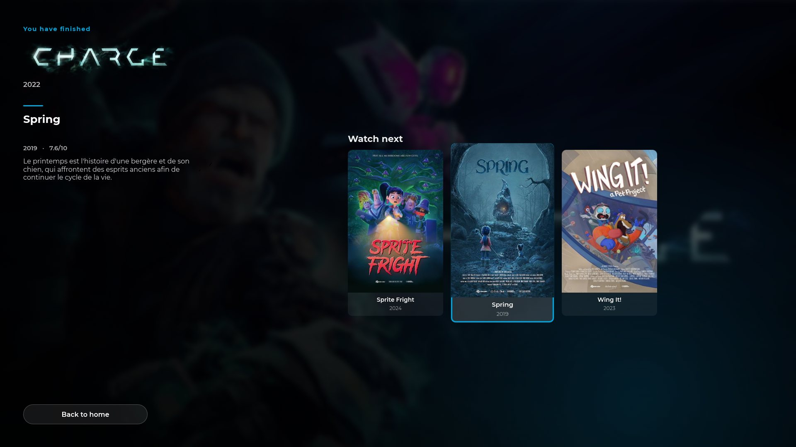
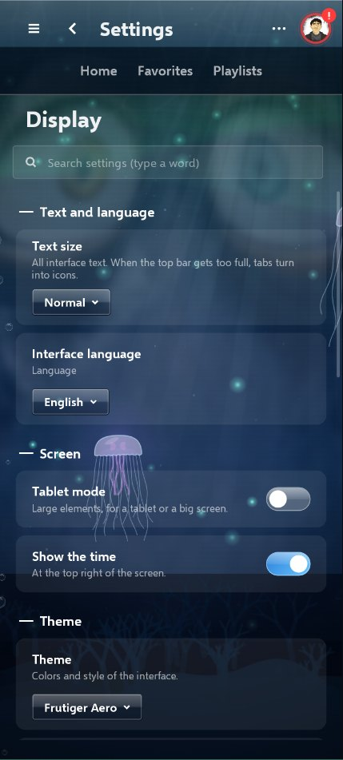

<p align="center">&nbsp;&nbsp;&nbsp;&nbsp;&nbsp;&nbsp;</p>

# Turtlefin

[English](README.md) · [Français](README.fr.md) · [Deutsch](README.de.md) · **Español** · [Italiano](README.it.md) · [Nederlands](README.nl.md) · [Polski](README.pl.md) · [Português](README.pt.md)

**Un cliente de Jellyfin nativo, ligero y animado, pensado tanto para el salón como para el escritorio.** Escrito en
Rust con Slint (interfaz) y libmpv (reproducción): sin Qt, sin navegador integrado. Funciona en cualquier ordenador
Windows o Linux, del portátil antiguo a la pequeña caja conectada a la televisión, y se usa igual de bien con el mando
a distancia que con el teclado y el ratón — y en Android (teléfono, tableta, televisión), con el dedo.

> **Proyecto totalmente «vibecodeado»**: todo el código, los textos y las traducciones los escribió una IA
> (Claude, de Anthropic), guiada y probada por una persona que no escribió el código.

Versión actual: **2.0.0** · Idiomas de la interfaz: Français, English, Español, Deutsch, Italiano, Português,
Polski, Nederlands — y cualquier idioma que usted añada (vea [Traducir Turtlefin](#traducir-turtlefin)).

> **Sobre esta versión.** La 2.0.0 se ha probado en Windows, en una Raspberry Pi 5 conectada a una televisión, en
> Linux y en Android (teléfono, emulador de televisión). Quedan cosas por revisar (vea las notas de las
> [versiones](https://github.com/Xelopteryx/Turtlefin/releases) y los problemas conocidos de
> [HANDOFF.es.md](HANDOFF.es.md)). Sus comentarios son bienvenidos en las
> [incidencias](https://github.com/Xelopteryx/Turtlefin/issues).

<p align="center"></p>

## Capturas

Los tres temas, cada uno con su decorado animado de día y de noche (aquí en un servidor de prueba con películas
libres de la Blender Foundation):

<p align="center">&nbsp;&nbsp;</p>

La ficha de una película, la pantalla final (lo que acaba de terminar y qué ver después) y «¿Quién está viendo?»:

<p align="center">&nbsp;&nbsp;</p>

La misma aplicación en un teléfono:

<p align="center">&nbsp;&nbsp;</p>

## Qué hace

- **Cuentas**: pantalla «¿Quién está viendo?» con fotos de perfil (GIF animados incluidos), hasta 12 cuentas
  guardadas en el dispositivo (solo el token, nunca la contraseña), código opcional por cuenta, cambio de cuenta sin
  volver a escribir. Búsqueda de servidores en todas las redes del dispositivo; una dirección principal y una de
  reserva, que se prueba cuando la principal no responde.
- **Inicio**: un logotipo animado cuyos siete puntos son comprobaciones reales (idioma, pantalla, reproductor de
  vídeo, almacenamiento, configuración, red y, en el centro, el servidor), luego «¿Quién está viendo?» — o directamente
  la cuenta elegida con Ajustes → Cuenta → **Abrir esta cuenta al iniciar**.
- **Pantalla de inicio**: banner, Mis medios, Continuar viendo, A continuación, Añadido recientemente; pestañas
  Favoritos, Para ver y Solicitudes (Seerr). Pósteres con episodios restantes, marca de «visto» y nota; el fondo
  procede del medio seleccionado.
- **Fichas**: película, serie, temporada, episodio; reproducir, favorito, visto, descarga, elección de audio /
  subtítulos recordada para toda la serie; nota, duración, estreno y, para una serie o una temporada, los
  **episodios vistos** («8 / 24» y el porcentaje); pestaña Detalles (géneros, estudios, personas, idiomas de audio con
  su bandera); «Más como esto» y sugerencias de Seerr; solicitar las temporadas que faltan.
- **Reproducción** (libmpv): capítulos, episodios de la temporada, «Saltar intro», episodio siguiente, tasa de bits
  máxima (por encima, el servidor convierte el vídeo), volumen propio; una **pantalla final** animada: lo que acaba de
  terminar y tres sugerencias, con el resumen de la elegida; posición y «visto» enviados al servidor.
- **Búsqueda** en la biblioteca y en Seerr: títulos, personas (con su filmografía ausente del servidor) y **estudios o
  cadenas** («disney», «pixar», «netflix»: sus películas y series para solicitar); filtros, búsqueda avanzada, medio
  al azar.
- **Seleccionar varias tarjetas** en las cuadrículas (pulsación larga, arrastrar con el ratón, OK mantenido en el
  mando), y luego solicitarlas o descargarlas de una vez.
- **Watch party** (SyncPlay): ver lo mismo al mismo tiempo en varios dispositivos.
- **Android** (teléfono, tableta, Android TV): la misma aplicación, en vertical y en horizontal, con el dedo
  (deslizar desde el borde izquierdo: atrás), volumen del teléfono, mando y gamepad de Android TV.
- **Enviar**: mandar un vídeo a otra pantalla — otro Turtlefin, una aplicación de Jellyfin de la cuenta o un
  Chromecast — y controlarlo desde el reproductor. **Mando**: controlar otro Turtlefin de la cuenta.
- **Páginas de Seerr**: un medio ausente del servidor se abre en su propia página (resumen, información, reparto),
  con Solicitar y **Tráiler**.
- **Temas**: Turtlefin, Frutiger Aero y Nerd, cada uno con su logotipo, su inicio y su decorado animado que sigue la
  hora; un tema propio (vea [Temas](#temas)). Sin conexión, toda la interfaz pasa al ámbar.
- **Sin conexión**: las descargas sustituyen a la pantalla de inicio, con fichas completas sin servidor; lo que se
  vio o se marcó como favorito sin conexión se envía a la cuenta al reconectar.
- **Mando, teclado, ratón y dedo en todas partes**: interfaz de TV (elementos grandes, teclado en pantalla) o
  interfaz de ordenador (ventana o pantalla completa, F11).
- **Ajustes** ordenados por categorías, con búsqueda: foto de perfil (GetAvatar), idiomas, subtítulos, reproducción,
  pantalla, tamaño del texto, red, almacenamiento, animaciones, mods, **actualización desde GitHub**.
- **Animaciones** en todas partes (póster que vuela hacia su ficha, banner que se abre, filas en cascada,
  transiciones entre páginas), ajustables una a una, con preajustes (Todas, Ligeras, Ninguna).
- **Fluidez**: Turtlefin mide lo que puede el dispositivo y aligera solo su decorado para mantener 60 imágenes por
  segundo.
- **Visita guiada** y **demostración** integradas («Descubrir Turtlefin» en el primer inicio), con películas libres
  reales; no se guarda nada.
- **Estado de Discord** (desactivado por defecto); **administradores**: editar un medio desde su ficha, panel de control.

## Requisitos del sistema

Medidos en una Raspberry Pi 5, un teléfono de gama de entrada (Galaxy A12s) y un emulador de Android limitado (un solo
núcleo limitado al 30 %: utilizable, animaciones a 15–50 imágenes por segundo; el mismo núcleo sin límite: animaciones a
60 imágenes por segundo).

**Mínimos** — todo funciona, animaciones desactivadas (Ajustes → Animaciones → **Ninguna**); el decorado se queda
quieto solo si el dispositivo no puede seguir:

- procesador de 64 bits de 4 núcleos a unos 1,5 GHz (Cortex-A53 / A55 de una televisión o de un teléfono de gama de
  entrada, Intel Celeron o Atom reciente);
- 2 GB de memoria (Turtlefin usa de 200 a 500 MB);
- aceleración gráfica OpenGL (Windows, Linux en PC) u OpenGL ES (Android, Raspberry Pi); decodificación de vídeo por
  hardware recomendada;
- Windows 10 u 11, Linux de 2022 o más reciente (Ubuntu 22.04, Debian 12…), Android 8 o más reciente.

**Recomendados** — todas las animaciones a 60 imágenes por segundo:

- procesador reciente de 4 núcleos a unos 2 GHz o más (Cortex-A76 de la Raspberry Pi 5, Intel Core i3 de 8.ª
  generación, AMD Ryzen 3 o mejor);
- 4 GB de memoria;
- decodificación por hardware HEVC de 10 bits para el 4K.

## Instalar

Nada que compilar: se descarga, se instala y listo. Todos los archivos están en la página
[Releases](https://github.com/Xelopteryx/Turtlefin/releases).

### Con un solo comando

**Windows** (PowerShell):

```powershell
irm https://raw.githubusercontent.com/Xelopteryx/Turtlefin/main/packaging/install.ps1 | iex
```

**Linux** (terminal):

```sh
curl -fsSL https://raw.githubusercontent.com/Xelopteryx/Turtlefin/main/packaging/install.sh | sh
```

En Windows, el último instalador se descarga y se ejecuta para su cuenta de usuario (sin derechos de administrador).
En Debian, Ubuntu, Linux Mint y las demás distribuciones con apt, se instala el paquete `.deb` (se le pide la
contraseña); en las demás, la AppImage va a `~/.local/bin` con una entrada en el menú de aplicaciones.

### A mano

- **Windows de 64 bits**: `Turtlefin-<version>-windows-x64-setup.exe` — instalador: idioma, carpeta y modo
  **instalado** (menú Inicio, desinstalación) o **portable**.
- **Windows de 64 bits, sin instalar**: `Turtlefin-<version>-windows-x64-portable.zip` — descomprimir donde quiera
  (memoria USB…) y ejecutar `turtlefin.exe`.
- **Windows de 32 bits** (PC antiguos): `…-windows-x86-setup.exe` o `…-windows-x86-portable.zip`.
- **Linux, cualquier distribución (x86_64)**: `Turtlefin-<version>-linux-x86_64.AppImage` — hacerla ejecutable
  (`chmod +x`) y lanzarla. ARM de 64 bits: `…-linux-aarch64.AppImage`.
- **Linux con Flatpak (x86_64)**: `Turtlefin-<version>-linux-x86_64.flatpak` —
  `flatpak install --user ./Turtlefin-….flatpak` (el runtime viene de Flathub).
- **Debian, Ubuntu, Mint…**: `turtlefin_<version>_amd64.deb` o `_arm64.deb` — doble clic, o
  `sudo apt install ./turtlefin_….deb`.
- **Android** (teléfono, tableta, televisión): `Turtlefin-<version>-android-arm64.apk` (televisión de 32 bits:
  `…-android-androidtv-armv7.apk`) — permitir la instalación desde este origen y abrir el archivo.

Las versiones de Windows y AppImage lo incluyen todo (reproductor libmpv incluido). El paquete `.deb` usa la libmpv
del sistema (`libmpv2`, instalada automáticamente por apt).

**Versión portable**: un archivo llamado `portable` junto a `turtlefin.exe` hace que la configuración, las cuentas, la
caché y las descargas se guarden en la carpeta `data` junto al programa; no se escribe nada en otro sitio.

### Actualizar

**Ajustes → Acerca de → Buscar actualizaciones** compara la versión instalada con la última publicada, y luego
**Actualizar** se encarga de todo según cómo esté instalado Turtlefin:

- **Windows, instalado**: el nuevo instalador se descarga y se ejecuta en silencio en la misma carpeta;
- **Windows, portable**: el nuevo archivo comprimido se descarga y sus archivos sustituyen a los antiguos;
- **AppImage**: el nuevo archivo sustituye al antiguo;
- **Paquete .deb**: el paquete se instala con `pkexec` (se pide la contraseña de administrador);
- **Flatpak**: no es automático — descargue el nuevo archivo `.flatpak` e instálelo de la misma manera.

**Reiniciar Turtlefin** lanza después la nueva versión.

## Plugins de servidor recomendados

Turtlefin funciona con un servidor Jellyfin sencillo (10.11 o más reciente). Estos plugins, instalados en el
**servidor**, añaden funciones:

- [**Jellyfin Enhanced**](https://github.com/n00bcodr/Jellyfin-Enhanced): pestaña Solicitudes, resultados de Seerr en
  la búsqueda (títulos, personas, estudios), sugerencias y solicitudes de Seerr en las fichas — con el inicio de sesión
  de Jellyfin, sin clave de Seerr en el cliente.
- [**Seerr**](https://github.com/seerr-team/seerr) (antes Jellyseerr): el propio gestor de solicitudes, usado por
  Jellyfin Enhanced.
- [**Intro Skipper**](https://github.com/intro-skipper/intro-skipper): detecta intros y créditos — botón «Saltar
  intro», salto automático, «Episodio siguiente» en el momento adecuado.
- [**GetAvatar**](https://github.com/cedev-1/jellyfin-plugin-GetAvatar): una galería de fotos de perfil para elegir en
  Ajustes → Cuenta.
- **Turtlefin Trailers** (en desarrollo, aún no publicado): descarga en el servidor los tráileres que faltan, en el
  idioma de cada biblioteca y de cada cuenta, y prepara los de las páginas de Seerr.

## Ejecutar

- `turtlefin`: animación de inicio y luego «¿Quién está viendo?» (o la cuenta de inicio).
- `turtlefin "Nombre"`: cuenta guardada «Nombre».
- `turtlefin "Nombre" --server=http://…`: conexión directa (contraseña en la variable `TURTLEFIN_PASSWORD`).
- `turtlefin --tv`: interfaz de TV (pantalla completa, elementos grandes); `--desktop`: interfaz de ordenador.
- `turtlefin --fullscreen`: pantalla completa sin la interfaz de TV; `--no-intro`: sin animación de inicio.
- `turtlefin --sub=fr --audio=ja`: subtítulos e idioma de audio de este inicio (`--sub=off`: ninguno).
- `turtlefin --lang=en`, `--theme=nerd`: idioma y tema (se conservan después).
- `turtlefin "Nombre" --play="Bleach S1E3"`: reproduce un episodio («Título» solo: una película, o reanuda la serie);
  `--open="Dragon Ball"`: abre su ficha.
- `turtlefin --demo`: demostración integrada; `--theme-creator`: Turtlefin Theme Creator; `--console`: ventana de
  registro (Windows); `--help`: todas las opciones.

La línea de comandos siempre prevalece sobre los ajustes (cuenta de inicio, interfaz de TV).

## Teclas y ratón

- **Flechas** para moverse, **Intro** para abrir / activar, **Esc** o **Retroceso** para volver.
- Inicio: **←** en la primera tarjeta (o Atrás) abre el menú; **↑** desde arriba de una página: barra superior.
- Reproducción, controles ocultos: **← →** retroceder / avanzar 10 s, **↑ ↓** o Intro muestran los controles;
  **Espacio**: pausa · `a` audio · `s` subtítulos · `f` pantalla completa.
- **F11**, en todas partes: pantalla completa (también en Ajustes → Pantalla, se conserva entre inicios).
- **Mando**: Stop, episodio siguiente / anterior, avance / retroceso rápido, Menú; OK mantenido sobre una tarjeta: su
  menú (o una selección de varias tarjetas en una cuadrícula).
- **Ratón**: clic para abrir, clic derecho para el menú de una tarjeta, rueda para pasar de una fila a otra (Mayús +
  rueda: dentro de la fila).
- **Dedo**: tocar abre, deslizar desplaza, desde el borde izquierdo: atrás; en una cuadrícula, una pulsación larga
  sobre una tarjeta inicia una selección de varias tarjetas.
- **Texto**: una letra tecleada va directamente al campo (búsqueda, conexión), incluso en la interfaz de TV.

## Archivos

- **Carpeta de configuración** (`turtlefin/`): `session.json` (sesión actual), `accounts.json` (cuentas guardadas),
  `prefs.json` (ajustes del dispositivo), `tracks.json` (pistas por serie), `userdata.json` (visto / favoritos sin
  conexión).
- **Carpeta de datos** (`turtlefin/downloads/`): descargas ordenadas como una biblioteca
  (`<biblioteca>/<serie>/Season 01/<serie> S01E01.mkv`, con imagen y subtítulos); `queue.json` (cola de espera).
- **Carpeta de caché** (`turtlefin/img/`): imágenes y fotos de perfil (se puede vaciar en Acerca de).
- **Documentos**: `Turtlefin Languages` (idiomas añadidos), `Turtlefin Themes` (temas), `Turtlefin Mods` (mods) y
  `Turtlefin Presets` (preajustes de animación exportados).

En Linux: `~/.config/turtlefin`, `~/.local/share/turtlefin`, `~/.cache/turtlefin`. En Windows:
`%APPDATA%\turtlefin\config`, `%APPDATA%\turtlefin\data`, `%LOCALAPPDATA%\turtlefin\cache`. Versión portable: todo en
`data\` junto a `turtlefin.exe`.

## Solución de problemas

- `turtlefin --console` (Windows) o un inicio desde un terminal (Linux) muestra el registro.
- `TURTLEFIN_MPV_LOG=/tmp/mpv.log`: registro de mpv · `TURTLEFIN_MPV_ARGS="…"`: opciones de mpv adicionales.
- `TURTLEFIN_HWDEC=no`: decodificación por software · `TURTLEFIN_AO=alsa`: salida de sonido.
- Líneas o interferencias en la imagen (NVIDIA): Ajustes → Reproducción → **Decodificación por hardware** desactivada.
- Dispositivo lento: Ajustes → Animaciones → **Ligeras** o **Ninguna**, y Ajustes → Pantalla → Tema →
  **Detalle del decorado** → Quieto.
- El renderizado debe ser OpenGL (elegido automáticamente): con `SLINT_BACKEND=winit-software`, no hay vídeo.

## Temas

Ajustes → Pantalla → **Tema**: **Turtlefin** (por defecto: hexágonos, violeta → azul, manchas de color que se
desplazan), **Frutiger Aero** (en el espíritu de Windows 7: cristal azulado, botones brillantes, una laguna a través de
cuya agua se ve la imagen del medio) y **Nerd** (una placa electrónica: el servidor es el procesador, la corriente
recorre las pistas) — o un tema propio. Cada decorado sigue la hora (día, atardecer, noche, amanecer), o se queda
siempre de día o de noche.

- **Crear un tema** abre el *Turtlefin Theme Creator* (ventana aparte, también en el menú Inicio): cada color, el
  redondeo, los reflejos, el fondo (imagen, GIF o vídeo), el logotipo y una música, con vista previa en directo.
  **Guardar** escribe el tema en la carpeta **Turtlefin Themes**; **Instalar** lo añade y lo elige.
- **Importar un tema** añade un tema recibido (su carpeta o su archivo `.tftheme`); **Exportar el tema** escribe el
  tema actual en esa carpeta, como punto de partida.

## Traducir Turtlefin

Sin programar ni compilar. Los idiomas añadidos viven en una sola carpeta, **Turtlefin Languages**: en **Documentos**
(versión instalada) o junto a `turtlefin.exe` (versión portable).

1. **Ajustes → Pantalla → Añadir un idioma** abre un explorador de esa carpeta; **Crear la plantilla** escribe en ella
   `modele.po`, con los textos en inglés y, como nota, el francés original.
2. Haga una copia llamada `<código>.po` (`sv.po` para el sueco, `ja.po` para el japonés…) y rellene cada `msgstr ""`
   con la traducción del `msgid` inglés de encima. Conserve los `{}` y `{n}`. Rellene también `X-Language-Name`
   (nombre mostrado) y, si hace falta, `Plural-Forms`. Sirve cualquier editor de `.po`, por ejemplo
   [Poedit](https://poedit.net).
3. De nuevo **Añadir un idioma**: la traducción aparece con la parte ya traducida; elegirla la aplica. Los textos
   dejados vacíos se muestran en inglés.

Para compartirla con todos: una pull request que añada el archivo a `lang/` (y a `BUILTIN` en `src/i18n.rs`);
`python tools/lang-check.py` comprueba que no falte nada.

## Desarrollo

Vea [HANDOFF.es.md](HANDOFF.es.md) (también en [Français](HANDOFF.md), [English](HANDOFF.en.md),
[Deutsch](HANDOFF.de.md), [Italiano](HANDOFF.it.md), [Nederlands](HANDOFF.nl.md), [Polski](HANDOFF.pl.md),
[Português](HANDOFF.pt.md)): estado del proyecto, decisiones, compilación, paquetes, publicación, traducciones,
problemas conocidos.

## Agradecimientos

Gracias a [LainX84](https://github.com/LainX84): sus sugerencias detalladas
([issue n.º 2](https://github.com/Xelopteryx/Turtlefin/issues/2)) dieron forma a buena parte de la 2.0 — un índice A–Z
y una barra de desplazamiento bien visible para las bibliotecas grandes, filtrado escribiendo las primeras letras de
un título, desplazamiento con rebote, tarjetas repartidas una sola vez por sesión (con un ajuste para desactivar la
animación) y el menú de las tarjetas (visto / no visto para volver a empezar, Identificar, Actualizar, Editar el
título). ¡Gracias por tomarse el tiempo de escribirlas!

## Licencia

Turtlefin se publica bajo la licencia [GNU GPL v3](LICENSE) (o una versión posterior): cualquiera puede usarlo,
estudiarlo, modificarlo y redistribuirlo, siempre que mantenga la misma licencia y comparta el código de sus cambios.
Las capturas muestran películas libres de la Blender Foundation (CC BY). La fuente Turtlefin Symbols procede de
DejaVu Sans (licencia en `ui/fonts/DejaVu-LICENSE.txt`).
