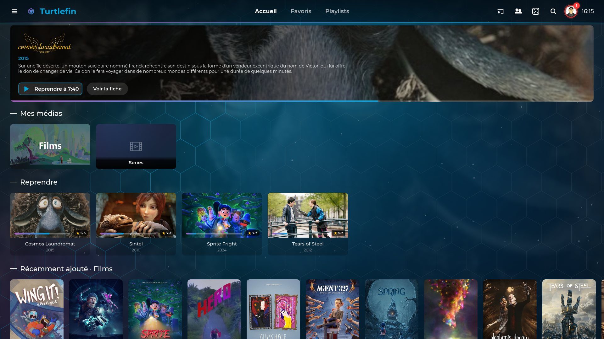
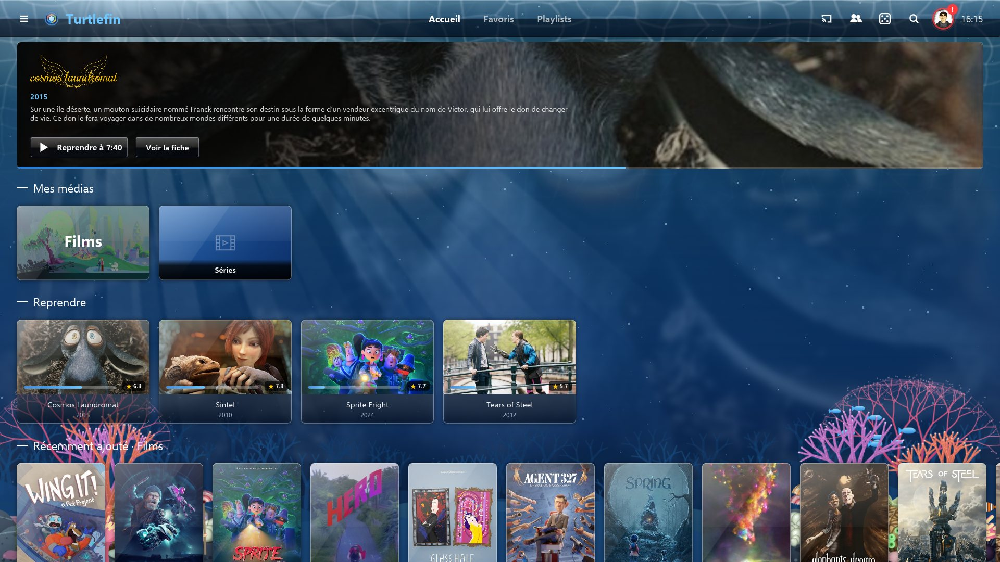
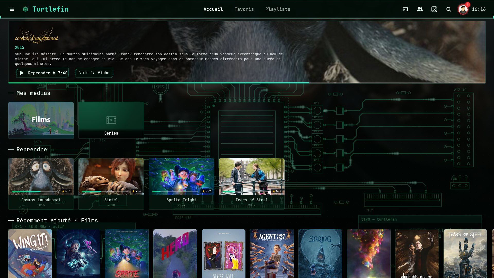
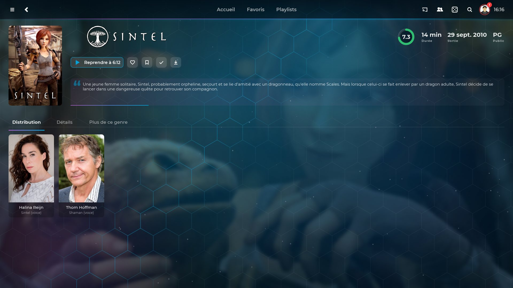
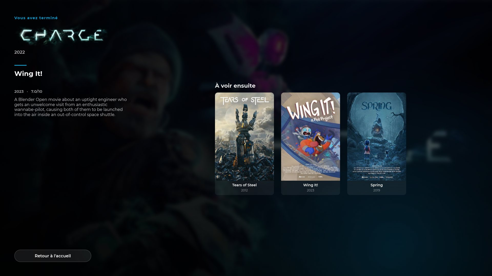
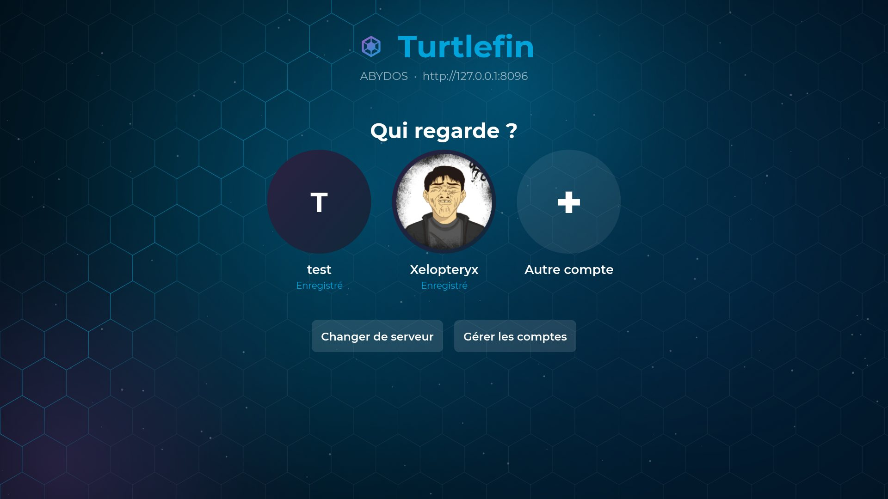
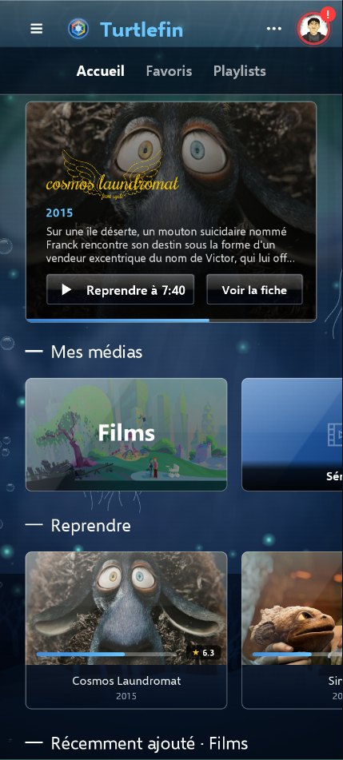
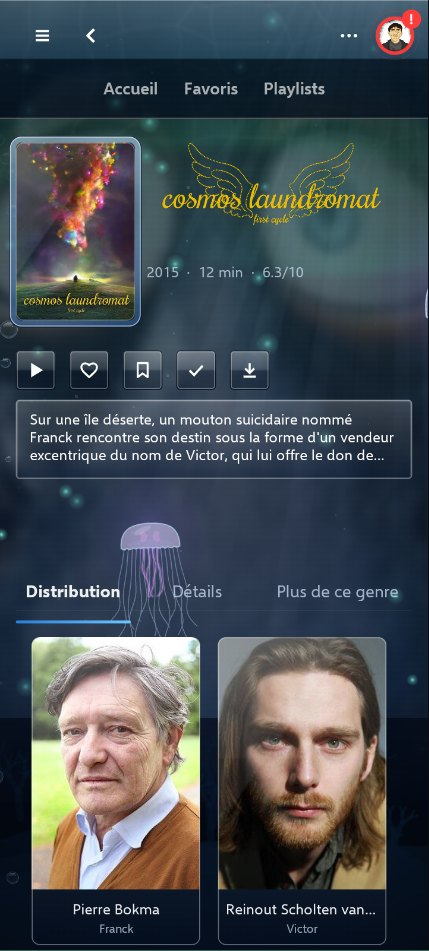
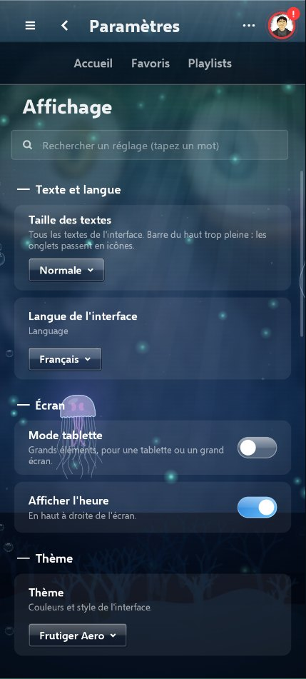

<p align="center">&nbsp;&nbsp;&nbsp;&nbsp;&nbsp;&nbsp;</p>

# Turtlefin

[English](README.md) · **Français** · [Deutsch](README.de.md) · [Español](README.es.md) · [Italiano](README.it.md) · [Nederlands](README.nl.md) · [Polski](README.pl.md) · [Português](README.pt.md)

**Client Jellyfin natif, léger et animé, pensé pour le salon comme pour le bureau.** Écrit en Rust avec Slint
(interface) et libmpv (lecture) : pas de Qt, pas de navigateur embarqué. Il tourne sur n'importe quel ordinateur
Windows ou Linux, du vieux portable au petit boîtier branché à la télé, et s'utilise aussi bien à la télécommande
qu'au clavier et à la souris — et sur Android (téléphone, tablette, télé), au doigt.

> **Projet entièrement vibecodé** : tout le code, les textes et les traductions ont été écrits par une IA
> (Claude, d'Anthropic), guidée et testée par un humain qui ne l'a pas programmé lui-même.

Version actuelle : **2.0.0** · Langues de l'interface : Français, English, Español, Deutsch, Italiano, Português,
Polski, Nederlands — et toute langue que vous ajoutez vous-même (voir [Traduire Turtlefin](#traduire-turtlefin)).

> **À propos de cette version.** La 2.0.0 a été testée sous Windows, sur Raspberry Pi 5 branché à une télé, sous Linux
> et sur Android (téléphone, émulateur de télé). Il reste des choses à revoir (voir les notes des
> [versions](https://github.com/Xelopteryx/Turtlefin/releases) et les problèmes connus de [HANDOFF.md](HANDOFF.md)).
> Vos retours sont les bienvenus dans les [tickets](https://github.com/Xelopteryx/Turtlefin/issues).

<p align="center"></p>

## Captures

Les trois thèmes, chacun avec son décor animé de jour et de nuit (ici sur un serveur d'essai garni de films libres
de la Blender Foundation) :

<p align="center">&nbsp;&nbsp;</p>

La fiche d'un film, l'écran de fin (ce que vous venez de finir, et quoi regarder ensuite) et « Qui regarde ? » :

<p align="center">&nbsp;&nbsp;</p>

La même application sur un téléphone :

<p align="center">&nbsp;&nbsp;</p>

## Ce qu'il sait faire

- **Comptes** : écran « Qui regarde ? » avec photos de profil (GIF animés compris), jusqu'à 12 comptes enregistrés
  sur l'appareil (le jeton seulement, jamais le mot de passe), code facultatif par compte, changement de compte sans
  ressaisie. Recherche des serveurs sur tous les réseaux de l'appareil ; une adresse principale et une adresse de
  secours, essayée quand la principale ne répond pas.
- **Démarrage** : logo animé dont les sept points sont de vraies vérifications (langue, affichage, lecteur vidéo,
  stockage, configuration, réseau et, au centre, le serveur), puis « Qui regarde ? » — ou directement le compte
  choisi avec Paramètres → Compte → **Ouvrir ce compte au démarrage**.
- **Accueil** : bannière, Mes médias, Reprendre, À suivre, Récemment ajouté ; onglets Favoris, À regarder et
  Demandes (Seerr). Affiches avec épisodes restants, coche « vu » et note ; fond d'écran tiré du média sélectionné.
- **Fiches** : film, série, saison, épisode ; lecture, favori, vu, téléchargement, choix audio / sous-titres
  retenu pour toute la série ; note, durée, sortie et, pour une série ou une saison, les **épisodes vus** (« 8 / 24 »
  et le pourcentage) ; onglet Détails (genres, studios, personnes, langues audio avec leur drapeau) ;
  « Plus de ce genre » et suggestions Seerr ; demande des saisons manquantes.
- **Lecture** (libmpv) : chapitres, épisodes de la saison, « Passer l'intro », épisode suivant, débit maximal (au-delà,
  le serveur convertit la vidéo), volume propre à Turtlefin ; **écran de fin** animé : ce que vous venez de finir et
  trois suggestions, avec le résumé de celle choisie ; position et « vu » renvoyés au serveur.
- **Recherche** dans la bibliothèque et dans Seerr : titres, personnes (avec leur filmographie absente du serveur)
  et **studios ou chaînes** (« disney », « pixar », « netflix » : leurs films et séries à demander) ; filtres, recherche
  avancée, média au hasard.
- **Sélection de plusieurs cartes** dans les grilles (appui long, glisser à la souris, OK maintenu à la télécommande),
  puis Demander ou Télécharger d'un coup.
- **Watch party** (SyncPlay) : regarder la même chose en même temps sur plusieurs appareils.
- **Android** (téléphone, tablette, Android TV) : la même application, en portrait comme en paysage, au doigt
  (glisser depuis le bord gauche : retour), volume du téléphone, télécommande et manette d'Android TV.
- **Diffuser** : envoyer une vidéo sur un autre écran — un autre Turtlefin, une appli Jellyfin du compte ou un
  Chromecast — et la piloter depuis le lecteur. **Télécommande** : piloter un autre Turtlefin du compte.
- **Pages Seerr** : un média absent du serveur s'ouvre sur sa propre page (résumé, informations, distribution),
  avec Demander et **Bande-annonce**.
- **Thèmes** : Turtlefin, Frutiger Aero et Nerd, chacun avec son logo, son démarrage et son décor animé qui suit
  l'heure ; un thème à vous (voir [Thèmes](#thèmes)). Hors ligne, toute l'interface passe à l'ambre.
- **Hors ligne** : les téléchargements remplacent l'accueil, avec des fiches complètes sans serveur ; ce qui a été
  vu ou mis en favori hors ligne est renvoyé au compte à la reconnexion.
- **Télécommande, clavier, souris et doigt partout** : interface TV (grands éléments, clavier à l'écran) ou
  interface ordinateur (fenêtre ou plein écran, F11).
- **Paramètres** rangés par catégories, avec une recherche : photo de profil (GetAvatar), langues, sous-titres,
  lecture, affichage, taille des textes, réseau, stockage, animations, mods, **mise à jour depuis GitHub**.
- **Animations** partout (affiche qui vole vers la fiche, bannière qui s'ouvre, rangées en cascade, transitions
  entre pages), réglables une par une, avec des presets (Toutes, Légères, Aucune).
- **Fluidité** : Turtlefin mesure ce que peut l'appareil et allège tout seul son décor pour tenir 60 images par seconde.
- **Visite guidée** et **démonstration** intégrées (« Découvrir Turtlefin » au premier lancement), avec de vrais
  films libres ; rien n'est enregistré.
- **Statut Discord** (coupé par défaut) ; **administrateurs** : modifier un média depuis sa fiche, tableau de bord.

## Configuration requise

Mesurée sur un Raspberry Pi 5, un téléphone d'entrée de gamme (Galaxy A12s) et un émulateur Android bridé
(un seul cœur limité à 30 % : utilisable, animations à 15–50 images par seconde ; le même cœur sans limite :
animations à 60 images par seconde).

**Minimale** — tout fonctionne, animations coupées (Paramètres → Animations → **Aucune**) ; le décor se fige
tout seul si l'appareil ne suit pas :

- processeur 64 bits à 4 cœurs vers 1,5 GHz (Cortex-A53 / A55 d'une télé ou d'un téléphone d'entrée de gamme,
  Intel Celeron ou Atom récent) ;
- 2 Go de mémoire (Turtlefin en utilise 200 à 500 Mo) ;
- accélération graphique OpenGL (Windows, Linux sur PC) ou OpenGL ES (Android, Raspberry Pi) ; décodage vidéo
  matériel conseillé ;
- Windows 10 ou 11, Linux de 2022 ou plus récent (Ubuntu 22.04, Debian 12…), Android 8 ou plus récent.

**Recommandée** — toutes les animations à 60 images par seconde :

- processeur à 4 cœurs récents vers 2 GHz ou plus (Cortex-A76 du Raspberry Pi 5, Intel Core i3 de 8ᵉ génération,
  AMD Ryzen 3, ou mieux) ;
- 4 Go de mémoire ;
- décodage matériel HEVC 10 bits pour la 4K.

## Installer

Rien à compiler : vous téléchargez, vous installez, c'est fini. Tous les fichiers sont sur la page
[Releases](https://github.com/Xelopteryx/Turtlefin/releases).

### En une commande

**Windows** (PowerShell) :

```powershell
irm https://raw.githubusercontent.com/Xelopteryx/Turtlefin/main/packaging/install.ps1 | iex
```

**Linux** (terminal) :

```sh
curl -fsSL https://raw.githubusercontent.com/Xelopteryx/Turtlefin/main/packaging/install.sh | sh
```

Sous Windows, le dernier installeur est téléchargé et lancé pour votre compte utilisateur (sans droits
administrateur). Sous Debian, Ubuntu, Linux Mint et les autres distributions à apt, c'est le paquet `.deb` qui est
installé (votre mot de passe est demandé) ; ailleurs, l'AppImage va dans `~/.local/bin` avec une entrée dans le menu
des applications.

### À la main

- **Windows 64 bits** : `Turtlefin-<version>-windows-x64-setup.exe` — installeur : langue, dossier, et mode
  **installé** (menu Démarrer, désinstallation) ou **portable**.
- **Windows 64 bits, sans installer** : `Turtlefin-<version>-windows-x64-portable.zip` — à décompresser où vous
  voulez (clé USB…), puis lancer `turtlefin.exe`.
- **Windows 32 bits** (vieux PC) : `…-windows-x86-setup.exe` ou `…-windows-x86-portable.zip`.
- **Linux, toutes distributions (x86_64)** : `Turtlefin-<version>-linux-x86_64.AppImage` — le rendre exécutable
  (`chmod +x`), puis le lancer. ARM 64 bits : `…-linux-aarch64.AppImage`.
- **Linux avec Flatpak (x86_64)** : `Turtlefin-<version>-linux-x86_64.flatpak` —
  `flatpak install --user ./Turtlefin-….flatpak` (le runtime vient de Flathub).
- **Debian, Ubuntu, Mint…** : `turtlefin_<version>_amd64.deb` ou `_arm64.deb` — double-clic, ou
  `sudo apt install ./turtlefin_….deb`.
- **Android** (téléphone, tablette, télé) : `Turtlefin-<version>-android-arm64.apk` (télé 32 bits :
  `…-android-androidtv-armv7.apk`) — autoriser l'installation depuis cette source, puis ouvrir le fichier.

Les versions Windows et AppImage contiennent tout (lecteur libmpv compris). Le paquet `.deb` utilise la libmpv du
système (`libmpv2`, installée automatiquement par apt).

**Version portable** : un fichier `portable` à côté de `turtlefin.exe` fait garder la configuration, les comptes, le
cache et les téléchargements dans le dossier `data` à côté du programme ; rien n'est écrit ailleurs.

### Mettre à jour

**Paramètres → À propos → Rechercher une mise à jour** compare la version installée à la dernière publiée, puis
**Mettre à jour** s'occupe de tout selon la façon dont Turtlefin est installé :

- **Windows, installé** : le nouvel installeur est téléchargé puis relancé en silence dans le même dossier ;
- **Windows, portable** : la nouvelle archive est téléchargée et ses fichiers remplacent les anciens ;
- **AppImage** : le nouveau fichier remplace l'ancien ;
- **Paquet .deb** : le paquet est installé avec `pkexec` (le mot de passe administrateur est demandé) ;
- **Flatpak** : pas automatique — téléchargez le nouveau fichier `.flatpak` et installez-le de la même façon.

**Redémarrer Turtlefin** lance ensuite la nouvelle version.

## Plugins serveur recommandés

Turtlefin fonctionne avec un serveur Jellyfin simple (10.11 ou plus récent). Ces plugins, à installer sur le
**serveur**, ajoutent des fonctions :

- [**Jellyfin Enhanced**](https://github.com/n00bcodr/Jellyfin-Enhanced) : onglet Demandes, résultats Seerr dans la
  recherche (titres, personnes, studios), suggestions et demandes Seerr sur les fiches — avec la connexion
  Jellyfin, sans clé Seerr côté client.
- [**Seerr**](https://github.com/seerr-team/seerr) (anciennement Jellyseerr) : le gestionnaire de demandes lui-même,
  utilisé par Jellyfin Enhanced.
- [**Intro Skipper**](https://github.com/intro-skipper/intro-skipper) : repère intros et génériques — bouton
  « Passer l'intro », saut automatique, « Épisode suivant » au bon moment.
- [**GetAvatar**](https://github.com/cedev-1/jellyfin-plugin-GetAvatar) : une galerie de photos de profil à choisir
  dans Paramètres → Compte.
- **Turtlefin Trailers** (en cours de développement, pas encore publié) : télécharge sur le serveur les bandes-annonces
  manquantes, dans la langue de chaque bibliothèque et de chaque compte, et prépare celles des pages Seerr.

## Lancer

- `turtlefin` : animation de démarrage, puis « Qui regarde ? » (ou le compte de démarrage).
- `turtlefin "Nom"` : compte enregistré « Nom ».
- `turtlefin "Nom" --server=http://…` : connexion directe (mot de passe dans la variable `TURTLEFIN_PASSWORD`).
- `turtlefin --tv` : interface TV (plein écran, grands éléments) ; `--desktop` : interface ordinateur.
- `turtlefin --fullscreen` : plein écran sans l'interface TV ; `--no-intro` : sans animation de démarrage.
- `turtlefin --sub=fr --audio=ja` : sous-titres et langue audio de ce lancement (`--sub=off` : aucun).
- `turtlefin --lang=en`, `--theme=nerd` : langue et thème (gardés ensuite).
- `turtlefin "Nom" --play="Bleach S1E3"` : lit un épisode (« Titre » seul : film, ou reprise de la série) ;
  `--open="Dragon Ball"` : ouvre la fiche.
- `turtlefin --demo` : démonstration intégrée ; `--theme-creator` : Turtlefin Theme Creator ;
  `--console` : fenêtre de journal (Windows) ; `--help` : toutes les options.

La ligne de commande l'emporte toujours sur les réglages (compte de démarrage, interface TV).

## Touches et souris

- **Flèches** pour se déplacer, **Entrée** pour ouvrir / activer, **Échap** ou **Retour arrière** pour revenir.
- Accueil : **←** sur la première carte (ou Retour) ouvre le menu ; **↑** depuis le haut d'une page : barre du haut.
- Lecture, commandes masquées : **← →** reculer / avancer de 10 s, **↑ ↓** ou Entrée affichent les commandes ;
  **Espace** : pause · `a` audio · `s` sous-titres · `f` plein écran.
- **F11**, partout : plein écran (aussi dans Paramètres → Affichage, gardé d'un lancement à l'autre).
- **Télécommande** : Stop, épisode suivant / précédent, avance / retour rapides, Menu ; OK maintenu sur une carte :
  son menu (ou une sélection de plusieurs cartes dans une grille).
- **Souris** : clic pour ouvrir, clic droit pour le menu d'une carte, molette pour passer d'une rangée à l'autre
  (Maj + molette : dans la rangée).
- **Doigt** : toucher ouvre, glisser fait défiler, depuis le bord gauche : retour ; dans une grille, un appui long sur
  une carte commence une sélection de plusieurs cartes.
- **Texte** : une lettre tapée au clavier va directement dans le champ (recherche, connexion), même en interface TV.

## Fichiers

- **Dossier de config** (`turtlefin/`) : `session.json` (session en cours), `accounts.json` (comptes enregistrés),
  `prefs.json` (réglages de l'appareil), `tracks.json` (pistes par série), `userdata.json` (vu / favoris faits hors ligne).
- **Dossier de données** (`turtlefin/downloads/`) : téléchargements rangés comme une bibliothèque
  (`<bibliothèque>/<série>/Season 01/<série> S01E01.mkv`, avec image et sous-titres) ; `queue.json` (file d'attente).
- **Dossier de cache** (`turtlefin/img/`) : images et photos de profil (vidable dans À propos).
- **Documents** : `Turtlefin Languages` (langues ajoutées), `Turtlefin Themes` (thèmes), `Turtlefin Mods` (mods)
  et `Turtlefin Presets` (presets d'animations exportés).

Sous Linux : `~/.config/turtlefin`, `~/.local/share/turtlefin`, `~/.cache/turtlefin`. Sous Windows :
`%APPDATA%\turtlefin\config`, `%APPDATA%\turtlefin\data`, `%LOCALAPPDATA%\turtlefin\cache`. Version portable : tout
dans `data\` à côté de `turtlefin.exe`.

## En cas de problème

- `turtlefin --console` (Windows) ou un lancement depuis un terminal (Linux) pour voir le journal.
- `TURTLEFIN_MPV_LOG=/tmp/mpv.log` : journal de mpv · `TURTLEFIN_MPV_ARGS="…"` : options mpv en plus.
- `TURTLEFIN_HWDEC=no` : décodage logiciel · `TURTLEFIN_AO=alsa` : sortie son.
- Lignes ou parasites dans l'image (NVIDIA) : Paramètres → Lecture → **Décodage matériel** coupé.
- Appareil lent : Paramètres → Animations → **Légères** ou **Aucune**, et Paramètres → Affichage → Thème →
  **Détail du décor** → Figé.
- Le rendu doit être OpenGL (choisi automatiquement) : avec `SLINT_BACKEND=winit-software`, pas de vidéo.

## Thèmes

Paramètres → Affichage → **Thème** : **Turtlefin** (par défaut : hexagones, violet → bleu, nappes de couleur),
**Frutiger Aero** (dans l'esprit de Windows 7 : verre bleuté, boutons brillants, un lagon où l'image du média se voit
à travers l'eau) et **Nerd** (une carte électronique : le serveur est le processeur, le courant parcourt les pistes)
— ou un thème à vous. Chaque décor suit l'heure (jour, crépuscule, nuit, aube), ou reste toujours de jour ou de nuit.

- **Créer un thème** ouvre le *Turtlefin Theme Creator* (fenêtre à part, aussi dans le menu Démarrer) : chaque
  couleur, l'arrondi, les reflets, le fond (image, GIF ou vidéo), le logo et une musique, avec un aperçu en direct.
  **Enregistrer** écrit le thème dans le dossier **Turtlefin Themes** ; **Installer** l'ajoute et le choisit.
- **Importer un thème** ajoute un thème reçu (son dossier ou son fichier `.tftheme`) ; **Exporter le thème** écrit le
  thème actuel dans ce dossier, comme point de départ.

## Traduire Turtlefin

Sans programmer ni compiler. Les langues ajoutées vivent dans un seul dossier, **Turtlefin Languages** : dans
**Documents** (version installée) ou à côté de `turtlefin.exe` (version portable).

1. **Paramètres → Affichage → Ajouter une langue** ouvre l'explorateur de ce dossier ; **Créer le modèle** y écrit
   `modele.po`, dont les textes sont en anglais, avec en note le français d'origine.
2. Faites-en une copie nommée `<code>.po` (`sv.po` pour le suédois, `ja.po` pour le japonais…) et remplissez chaque
   `msgstr ""` avec la traduction du `msgid` anglais au-dessus. Gardez les `{}` et `{n}`. Remplissez aussi
   `X-Language-Name` (nom affiché) et, si besoin, `Plural-Forms`. N'importe quel éditeur de `.po` convient, par
   exemple [Poedit](https://poedit.net).
3. De nouveau **Ajouter une langue** : la traduction apparaît avec la part déjà traduite ; la choisir l'applique. Les
   textes laissés vides s'affichent en anglais.

Pour la partager avec tout le monde : une pull request qui ajoute le fichier à `lang/` (et à `BUILTIN` dans
`src/i18n.rs`) ; `python tools/lang-check.py` vérifie qu'il ne manque rien.

## Développement

Voir [HANDOFF.md](HANDOFF.md) (aussi en [English](HANDOFF.en.md), [Deutsch](HANDOFF.de.md),
[Español](HANDOFF.es.md), [Italiano](HANDOFF.it.md), [Nederlands](HANDOFF.nl.md), [Polski](HANDOFF.pl.md),
[Português](HANDOFF.pt.md)) : état du projet, décisions, compilation, paquets, publication, traductions,
problèmes connus.

## Remerciements

Merci à [LainX84](https://github.com/LainX84) : ses suggestions détaillées
([ticket n° 2](https://github.com/Xelopteryx/Turtlefin/issues/2)) ont façonné une bonne partie de la 2.0 — index A–Z
et barre de défilement bien visible pour les grandes bibliothèques, filtre en tapant les premières lettres d'un titre,
défilement à ressort, cartes distribuées une seule fois par session (avec un réglage pour couper l'animation), menu
des cartes (vu / non vu pour recommencer, Identifier, Actualiser, Modifier le titre). Merci d'avoir pris le temps de
les écrire !

## Licence

Turtlefin est publié sous licence [GNU GPL v3](LICENSE) (ou version ultérieure) : chacun peut l'utiliser, l'étudier,
le modifier et le redistribuer, à condition de garder la même licence et de partager le code de ses modifications.
Les captures montrent des films libres de la Blender Foundation (CC BY). La police Turtlefin Symbols est tirée de
DejaVu Sans (licence dans `ui/fonts/DejaVu-LICENSE.txt`).
