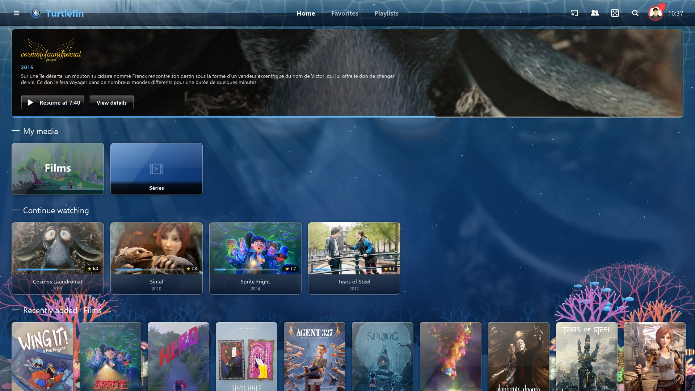
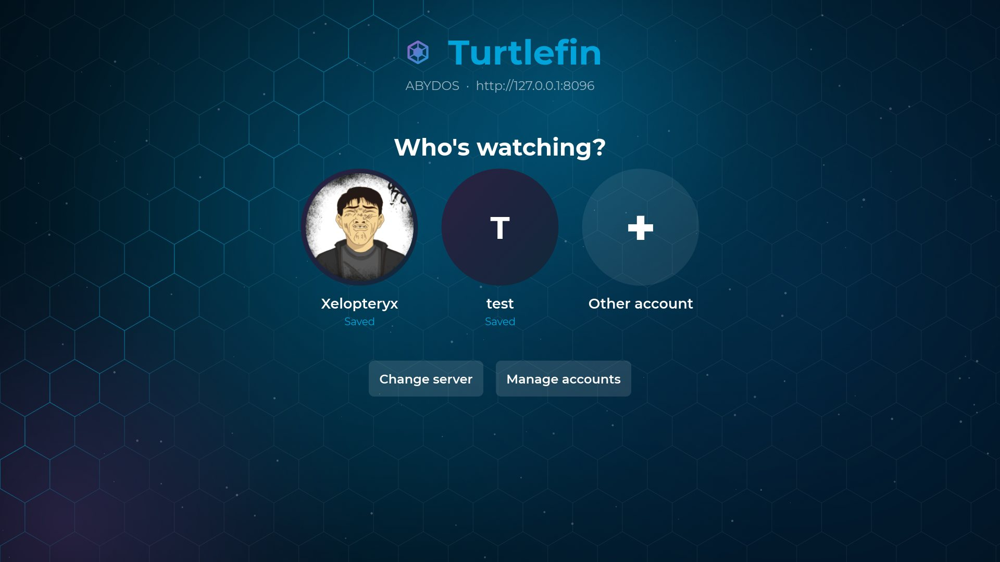
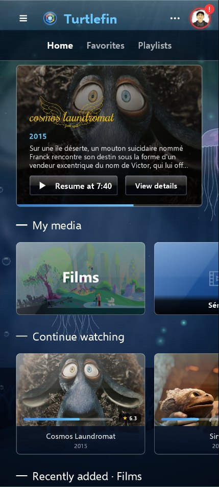
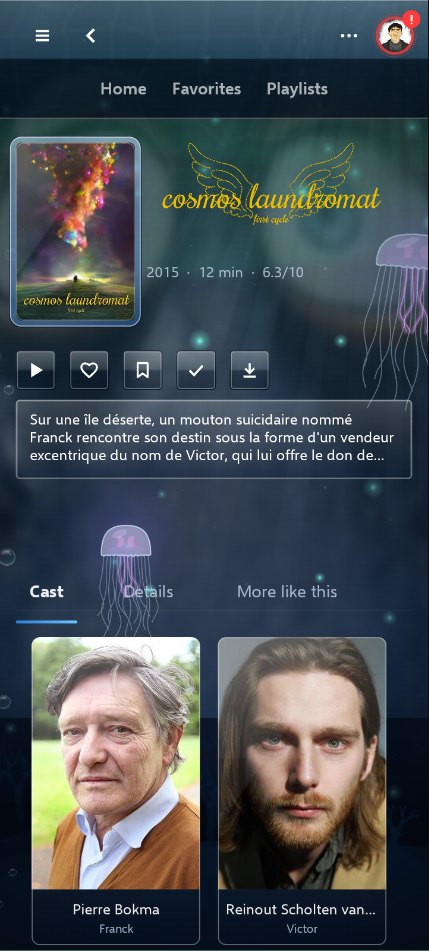

<p align="center">&nbsp;&nbsp;&nbsp;&nbsp;&nbsp;&nbsp;</p>

# Turtlefin

**English** · [Français](README.fr.md) · [Deutsch](README.de.md) · [Español](README.es.md) · [Italiano](README.it.md) · [Nederlands](README.nl.md) · [Polski](README.pl.md) · [Português](README.pt.md)

**A native, lightweight, animated Jellyfin client, made for the living room as much as for the desk.** Written in
Rust with Slint (interface) and libmpv (playback): no Qt, no embedded browser. It runs on any Windows or Linux
computer, from an old laptop to a small box plugged into the TV, and works just as well with a remote as with a
keyboard and mouse — and on Android phones, tablets and TVs, with your finger.

> **Fully vibecoded project**: all the code, texts and translations were written by an AI (Claude, by
> Anthropic), guided and tested by a human who did not write any of the code.

Current version: **2.0.0** · Interface languages: English, Français, Español, Deutsch, Italiano, Português,
Polski, Nederlands — and any language you add yourself (see [Translate Turtlefin](#translate-turtlefin)).

> **About this version.** 2.0.0 has been tested on Windows, on a Raspberry Pi 5 plugged into a TV, on Linux and on
> Android (phone, TV emulator). Some things still need work (see the
> [Releases](https://github.com/Xelopteryx/Turtlefin/releases) notes and the known issues in
> [HANDOFF.en.md](HANDOFF.en.md)). Feedback is welcome in the [issues](https://github.com/Xelopteryx/Turtlefin/issues).

<p align="center"></p>

## Screenshots

The three themes, each with its own animated day and night background (here on a test server stocked with free
films from the Blender Foundation):

<p align="center">&nbsp;&nbsp;</p>

A film's page, the end screen (what you just finished, and what to watch next) and “Who's watching?”:

<p align="center">&nbsp;&nbsp;</p>

The same app on a phone:

<p align="center">&nbsp;&nbsp;</p>

## What it does

- **Accounts**: “Who's watching?” screen with profile pictures (animated GIFs included), up to 12 accounts saved on
  the device (the token only, never the password), optional code per account, account switching without typing
  again. Server discovery on every network of the device; a main address and a backup address, tried when the
  main one does not answer.
- **Startup**: an animated logo whose seven dots are real checks (language, display, video player, storage,
  configuration, network and, in the center, the server), then “Who's watching?” — or straight into the chosen
  account with Settings → Account → **Open this account at startup**.
- **Home**: banner, My media, Continue watching, Next up, Recently added; Favorites, Watchlist and Requests (Seerr)
  tabs. Posters show remaining episodes, a “watched” check and the rating; the background comes from the selected
  item.
- **Item pages**: film, series, season, episode; play, favorite, watched, download, audio / subtitle choice
  remembered for the whole series; rating, runtime, release date and, for a series or a season, the **episodes
  watched** (“8 / 24” and the percentage); Details tab (genres, studios, people, audio languages with their flag);
  “More like this” and Seerr suggestions; request the missing seasons.
- **Playback** (libmpv): chapters, the season's episodes, “Skip intro”, next episode, maximum bitrate (above it, the
  server converts the video), Turtlefin's own volume; an animated **end screen**: what you just finished and three
  suggestions, with the summary of the one you pick; position and “watched” sent back to the server.
- **Search** in the library and in Seerr: titles, people (with their filmography missing from the server) and
  **studios or networks** (“disney”, “pixar”, “netflix”: their films and series to request); filters, advanced
  search, random item.
- **Libraries**: grid with an A–Z index and a scrollbar, filtering by typing the first letters of a title; a menu on
  every card (right click, long press, held OK): watched / unwatched, Download, Request and, for an administrator,
  Identify, Refresh, Edit. Media already requested show the state of their request.
- **Select several cards** in grids (long press, mouse drag, OK held on the remote), then Request or Download them
  all at once.
- **Watch party** (SyncPlay): watch the same thing at the same time on several devices.
- **Android** (phone, tablet, Android TV): the same app, in portrait and landscape, with the finger (swipe from the
  left edge: back), phone volume, Android TV remote and gamepad.
- **Cast**: send a video to another screen — another Turtlefin, a Jellyfin app of the account or a Chromecast — and
  control it from the player. **Remote**: control another Turtlefin of the account.
- **Seerr pages**: an item missing from the server opens on its own page (summary, information, cast), with Request
  and **Trailer**.
- **Themes**: Turtlefin, Frutiger Aero and Nerd, each with its own logo, startup and animated background that
  follows the time of day; a theme of your own (see [Themes](#themes)). Offline, the whole interface turns amber.
- **Offline**: downloads replace the home screen, with complete item pages without a server; what was watched or
  favorited offline is sent to the account when it reconnects.
- **Remote, keyboard, mouse and finger everywhere**: TV interface (large elements, on-screen keyboard) or desktop
  interface (window or full screen, F11).
- **Settings** sorted by category, with a search: profile picture (GetAvatar), languages, subtitles, playback,
  display, text size, network, storage, animations, mods, **update from GitHub**.
- **Animations** everywhere (poster flying to its page, banner opening, cascading rows, transitions between pages),
  adjustable one by one, with presets (All, Light, None).
- **Smoothness**: Turtlefin measures what the device can do and lightens its background by itself to hold 60
  frames per second.
- Built-in **guided tour** and **demo** (“Discover Turtlefin” on first launch), with real free films; nothing is saved.
- **Discord status** (off by default); **administrators**: edit an item from its page, dashboard.

## System requirements

Measured on a Raspberry Pi 5, an entry-level phone (Galaxy A12s) and a throttled Android emulator (a single core
limited to 30%: usable, animations at 15–50 frames per second; the same core unthrottled: animations at 60 frames
per second).

**Minimum** — everything works, animations off (Settings → Animations → **None**); the background freezes by itself
if the device cannot keep up:

- 64-bit 4-core processor around 1.5 GHz (the Cortex-A53 / A55 of a TV or an entry-level phone, a recent Intel
  Celeron or Atom);
- 2 GB of memory (Turtlefin uses 200 to 500 MB);
- OpenGL (Windows, Linux on PC) or OpenGL ES (Android, Raspberry Pi) graphics acceleration; hardware video decoding
  recommended;
- Windows 10 or 11, Linux from 2022 or newer (Ubuntu 22.04, Debian 12…), Android 8 or newer.

**Recommended** — every animation at 60 frames per second:

- recent 4-core processor around 2 GHz or more (the Cortex-A76 of the Raspberry Pi 5, an 8th-generation Intel Core i3,
  an AMD Ryzen 3, or better);
- 4 GB of memory;
- hardware HEVC 10-bit decoding for 4K.

## Install

Nothing to compile: download, install, done. All files are on the
[Releases](https://github.com/Xelopteryx/Turtlefin/releases) page.

### One command

**Windows** (PowerShell):

```powershell
irm https://raw.githubusercontent.com/Xelopteryx/Turtlefin/main/packaging/install.ps1 | iex
```

**Linux** (terminal):

```sh
curl -fsSL https://raw.githubusercontent.com/Xelopteryx/Turtlefin/main/packaging/install.sh | sh
```

On Windows, the latest installer is downloaded and run for your user account (no administrator rights). On Debian,
Ubuntu, Linux Mint and the other apt distributions, the `.deb` package is installed (your password is asked);
elsewhere, the AppImage goes to `~/.local/bin` with an entry in the applications menu.

### By hand

- **Windows 64-bit**: `Turtlefin-<version>-windows-x64-setup.exe` — installer: language, folder, and **installed**
  (Start menu, uninstall) or **portable** mode.
- **Windows 64-bit, without installing**: `Turtlefin-<version>-windows-x64-portable.zip` — unzip wherever you want
  (USB stick…), then run `turtlefin.exe`.
- **Windows 32-bit** (old PCs): `…-windows-x86-setup.exe` or `…-windows-x86-portable.zip`.
- **Linux, any distribution (x86_64)**: `Turtlefin-<version>-linux-x86_64.AppImage` — make it executable
  (`chmod +x`), then run it. ARM 64-bit: `…-linux-aarch64.AppImage`.
- **Linux with Flatpak (x86_64)**: `Turtlefin-<version>-linux-x86_64.flatpak` —
  `flatpak install --user ./Turtlefin-….flatpak` (the runtime comes from Flathub).
- **Debian, Ubuntu, Mint…**: `turtlefin_<version>_amd64.deb` or `_arm64.deb` — double-click, or
  `sudo apt install ./turtlefin_….deb`.
- **Android** (phone, tablet, TV): `Turtlefin-<version>-android-arm64.apk` (32-bit TV:
  `…-android-androidtv-armv7.apk`) — allow installing from this source, then open the file.

The Windows and AppImage versions contain everything (libmpv player included). The `.deb` package uses the system's
libmpv (`libmpv2`, installed automatically by apt).

**Portable version**: a file named `portable` next to `turtlefin.exe` keeps the configuration, accounts, cache and
downloads in the `data` folder next to the program; nothing is written anywhere else.

### Update

**Settings → About → Check for updates** compares the installed version with the latest release, then **Update**
takes care of everything depending on how Turtlefin is installed:

- **Windows, installed**: the new installer is downloaded and run silently in the same folder;
- **Windows, portable**: the new archive is downloaded and its files replace the old ones;
- **AppImage**: the new file replaces the old one;
- **.deb package**: the package is installed with `pkexec` (the administrator password is asked);
- **Flatpak**: not automatic — download the new `.flatpak` file and install it the same way.

**Restart Turtlefin** then launches the new version.

## Recommended server plugins

Turtlefin works with a plain Jellyfin server (10.11 or newer). These plugins, installed on the **server**, add
features:

- [**Jellyfin Enhanced**](https://github.com/n00bcodr/Jellyfin-Enhanced): Requests tab, Seerr results in search
  (titles, people, studios), Seerr suggestions and requests on item pages — through the Jellyfin login, with no
  Seerr key on the client.
- [**Seerr**](https://github.com/seerr-team/seerr) (formerly Jellyseerr): the request manager itself, used by
  Jellyfin Enhanced.
- [**Intro Skipper**](https://github.com/intro-skipper/intro-skipper): finds intros and credits — “Skip intro”
  button, automatic skip, “Next episode” at the right time.
- [**GetAvatar**](https://github.com/cedev-1/jellyfin-plugin-GetAvatar): a gallery of profile pictures to choose
  from in Settings → Account.
- **Turtlefin Trailers** (in development, not released yet): downloads missing trailers to the server, in the language
  of each library and each account, and prepares those of Seerr pages.

## Launch

- `turtlefin`: startup animation, then “Who's watching?” (or the startup account).
- `turtlefin "Name"`: saved account “Name”.
- `turtlefin "Name" --server=http://…`: direct login (password in the `TURTLEFIN_PASSWORD` variable).
- `turtlefin --tv`: TV interface (full screen, large elements); `--desktop`: desktop interface.
- `turtlefin --fullscreen`: full screen without the TV interface; `--no-intro`: no startup animation.
- `turtlefin --sub=fr --audio=ja`: subtitles and audio language for this launch (`--sub=off`: none).
- `turtlefin --lang=en`, `--theme=nerd`: language and theme (kept afterwards).
- `turtlefin "Name" --play="Bleach S1E3"`: plays an episode (“Title” alone: a film, or resumes the series);
  `--open="Dragon Ball"`: opens its page.
- `turtlefin --demo`: built-in demo; `--theme-creator`: Turtlefin Theme Creator; `--console`: log window
  (Windows); `--help`: every option.

The command line always wins over the settings (startup account, TV interface).

## Keys and mouse

- **Arrows** to move, **Enter** to open / activate, **Esc** or **Backspace** to go back.
- Home: **←** on the first card (or Back) opens the menu; **↑** from the top of a page: top bar.
- Playback, controls hidden: **← →** back / forward 10 s, **↑ ↓** or Enter show the controls; **Space**: pause ·
  `a` audio · `s` subtitles · `f` full screen.
- **F11**, everywhere: full screen (also in Settings → Display, kept from one launch to the next).
- **Remote**: Stop, next / previous episode, fast forward / rewind, Menu; OK held on a card: its menu (or a
  selection of several cards in a grid).
- **Mouse**: click to open, right-click for a card's menu, wheel to move from row to row (Shift + wheel: within the row).
- **Finger**: tap opens, swipe scrolls, from the left edge: back; in a grid, a long press on a card starts a
  selection of several cards.
- **Text**: a letter typed on the keyboard goes straight into the field (search, login), even in the TV interface.

## Files

- **Config folder** (`turtlefin/`): `session.json` (current session), `accounts.json` (saved accounts),
  `prefs.json` (device settings), `tracks.json` (tracks per series), `userdata.json` (watched / favorites done offline).
- **Data folder** (`turtlefin/downloads/`): downloads sorted like a library
  (`<library>/<series>/Season 01/<series> S01E01.mkv`, with image and subtitles); `queue.json` (waiting list).
- **Cache folder** (`turtlefin/img/`): images and profile pictures (can be emptied in About).
- **Documents**: `Turtlefin Languages` (added languages), `Turtlefin Themes` (themes), `Turtlefin Mods` (mods) and
  `Turtlefin Presets` (exported animation presets).

On Linux: `~/.config/turtlefin`, `~/.local/share/turtlefin`, `~/.cache/turtlefin`. On Windows:
`%APPDATA%\turtlefin\config`, `%APPDATA%\turtlefin\data`, `%LOCALAPPDATA%\turtlefin\cache`. Portable version:
everything in `data\` next to `turtlefin.exe`.

## Troubleshooting

- `turtlefin --console` (Windows) or launching from a terminal (Linux) shows the log.
- `TURTLEFIN_MPV_LOG=/tmp/mpv.log`: mpv log · `TURTLEFIN_MPV_ARGS="…"`: extra mpv options.
- `TURTLEFIN_HWDEC=no`: software decoding · `TURTLEFIN_AO=alsa`: audio output.
- Lines or artifacts in the picture (NVIDIA): Settings → Playback → **Hardware decoding** off.
- Slow device: Settings → Animations → **Light** or **None**, and Settings → Display → Theme → **Scenery
  detail** → Still.
- Rendering must be OpenGL (chosen automatically): with `SLINT_BACKEND=winit-software`, no video.

## Themes

Settings → Display → **Theme**: **Turtlefin** (default: hexagons, purple → blue, drifting color blobs),
**Frutiger Aero** (in the spirit of Windows 7: bluish glass, glossy buttons, a lagoon where the item's picture shows
through the water) and **Nerd** (a circuit board: the server is the processor, current runs through the tracks) — or
a theme of your own. Each background follows the time of day (day, dusk, night, dawn), or always stays day or night.

- **Create a theme** opens the *Turtlefin Theme Creator* (a separate window, also in the Start menu): every color,
  the corner radius, the highlights, the background (image, GIF or video), the logo and a music, with a live
  preview. **Save** writes the theme to the **Turtlefin Themes** folder; **Install** adds it and selects it.
- **Import a theme** adds a theme you received (its folder or its `.tftheme` file); **Export the theme** writes the
  current theme to that folder, as a starting point.

## Translate Turtlefin

No programming, no compiling. Added languages live in a single folder, **Turtlefin Languages**: in **Documents**
(installed version) or next to `turtlefin.exe` (portable version).

1. **Settings → Display → Add a language** opens an explorer of that folder; **Create the template** writes
   `modele.po` there, with the texts in English and, as notes, the original French.
2. Copy it as `<code>.po` (`sv.po` for Swedish, `ja.po` for Japanese…) and fill each `msgstr ""` with the
   translation of the English `msgid` above it. Keep the `{}` and `{n}`. Also fill `X-Language-Name` (displayed
   name) and, if needed, `Plural-Forms`. Any `.po` editor works, for example [Poedit](https://poedit.net).
3. **Add a language** again: the translation appears with how much of it is done; choosing it applies it. Texts
   left empty are shown in English.

To share it with everyone: a pull request that adds the file to `lang/` (and to `BUILTIN` in `src/i18n.rs`);
`python tools/lang-check.py` checks that nothing is missing.

## Development

See [HANDOFF.en.md](HANDOFF.en.md) (also in [Français](HANDOFF.md), [Deutsch](HANDOFF.de.md),
[Español](HANDOFF.es.md), [Italiano](HANDOFF.it.md), [Nederlands](HANDOFF.nl.md), [Polski](HANDOFF.pl.md),
[Português](HANDOFF.pt.md)): project state, decisions, building, packages, publishing, translations, known issues.

## Thanks

Thanks to [LainX84](https://github.com/LainX84): their detailed suggestions
([issue #2](https://github.com/Xelopteryx/Turtlefin/issues/2)) shaped a large part of 2.0 — an A–Z index and a clearly
visible scrollbar for large libraries, filtering by typing the first letters of a title, springy scrolling, cards
dealt only once per session (with a setting to turn the animation off), and the card menu (watched / unwatched to
start over, Identify, Refresh, Edit title). Thank you for taking the time to write them!

## License

Turtlefin is released under the [GNU GPL v3](LICENSE) (or any later version): anyone may use, study, modify and
redistribute it, as long as they keep the same license and share the source code of their changes. The screenshots
show free films from the Blender Foundation (CC BY). The Turtlefin Symbols font is derived from DejaVu Sans (license
in `ui/fonts/DejaVu-LICENSE.txt`).
