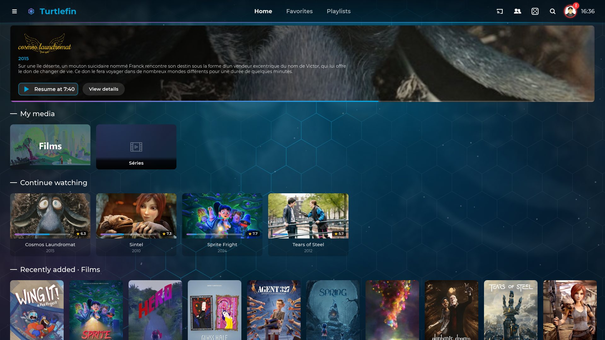
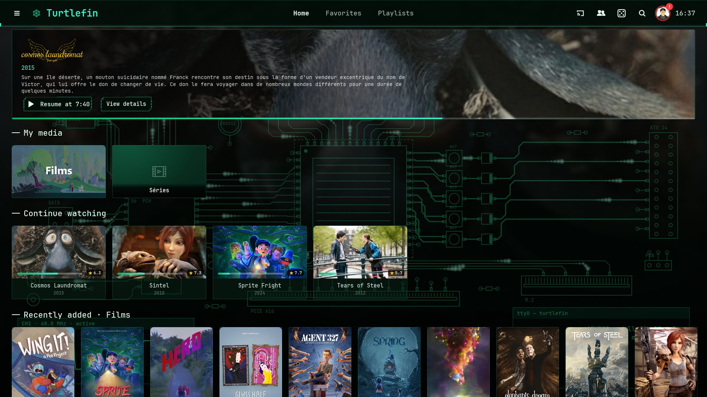
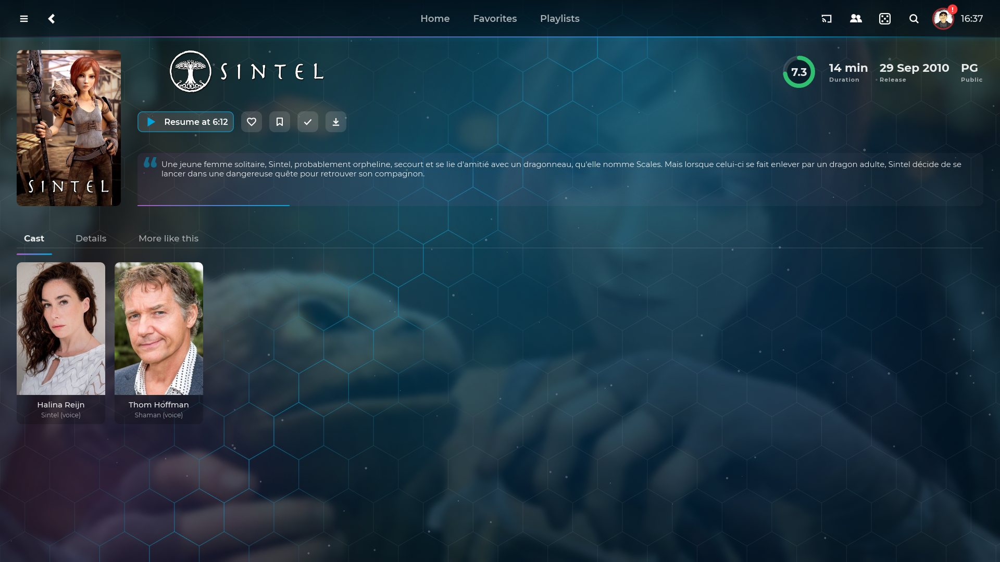

<p align="center">&nbsp;&nbsp;&nbsp;&nbsp;&nbsp;&nbsp;</p>

# Turtlefin

[English](README.md) · [Français](README.fr.md) · [Deutsch](README.de.md) · [Español](README.es.md) · [Italiano](README.it.md) · [Nederlands](README.nl.md) · [Polski](README.pl.md) · **Português**

**Um cliente Jellyfin nativo, leve e animado, pensado tanto para a sala como para a secretária.** Escrito em Rust com
Slint (interface) e libmpv (reprodução): sem Qt, sem navegador embutido. Funciona em qualquer computador Windows ou
Linux, do portátil antigo à pequena caixa ligada à televisão, e usa-se tão bem com o comando como com o teclado e o rato
— e no Android (telemóvel, tablet, televisão), com o dedo.

> **Projeto totalmente «vibecodado»**: todo o código, os textos e as traduções foram escritos por uma IA (Claude, da
> Anthropic), orientada e testada por uma pessoa que não escreveu o código.

Versão atual: **2.0.0** · Idiomas da interface: Français, English, Español, Deutsch, Italiano, Português, Polski,
Nederlands — e qualquer idioma que acrescente (ver [Traduzir o Turtlefin](#traduzir-o-turtlefin)).

> **Sobre esta versão.** A 2.0.0 foi testada no Windows, num Raspberry Pi 5 ligado a uma televisão, no Linux e no
> Android (telemóvel, emulador de televisão). Ainda há coisas a rever (ver as notas das
> [versões](https://github.com/Xelopteryx/Turtlefin/releases) e os problemas conhecidos em
> [HANDOFF.pt.md](HANDOFF.pt.md)). Os seus comentários são bem-vindos nas
> [issues](https://github.com/Xelopteryx/Turtlefin/issues).

<p align="center"></p>

## Capturas

Os três temas, cada um com o seu cenário animado de dia e de noite (aqui num servidor de teste com filmes livres da
Blender Foundation):

<p align="center">&nbsp;&nbsp;</p>

A página de um filme, o ecrã final (o que acabou de ver e o que ver a seguir) e «Quem está a ver?»:

<p align="center">&nbsp;&nbsp;</p>

A mesma aplicação num telemóvel:

<p align="center">&nbsp;&nbsp;</p>

## O que faz

- **Contas**: ecrã «Quem está a ver?» com fotos de perfil (GIF animados incluídos), até 12 contas guardadas no
  dispositivo (só o token, nunca a palavra-passe), código opcional por conta, troca de conta sem voltar a escrever.
  Procura de servidores em todas as redes do dispositivo; um endereço principal e um de reserva, experimentado quando o
  principal não responde.
- **Arranque**: um logótipo animado cujos sete pontos são verificações reais (idioma, ecrã, leitor de vídeo,
  armazenamento, configuração, rede e, ao centro, o servidor), depois «Quem está a ver?» — ou diretamente a conta
  escolhida com Definições → Conta → **Abrir esta conta ao iniciar**.
- **Início**: banner, Os meus conteúdos, Continuar a ver, A seguir, Adicionados recentemente; separadores Favoritos,
  Para ver e Pedidos (Seerr). Cartazes com episódios restantes, visto e classificação; o fundo vem do conteúdo
  selecionado.
- **Páginas**: filme, série, temporada, episódio; reproduzir, favorito, visto, transferência, escolha de áudio /
  legendas memorizada para a série inteira; classificação, duração, estreia e, para uma série ou temporada, os
  **episódios vistos** («8 / 24» e a percentagem); separador Detalhes (géneros, estúdios, pessoas, idiomas de áudio com
  a sua bandeira); «Mais deste género» e sugestões do Seerr; pedido das temporadas em falta.
- **Reprodução** (libmpv): capítulos, episódios da temporada, «Saltar intro», episódio seguinte, débito máximo (acima
  dele, o servidor converte o vídeo), volume próprio; um **ecrã final** animado: o que acabou de ver e três sugestões,
  com o resumo da escolhida; posição e «visto» enviados ao servidor.
- **Pesquisa** na biblioteca e no Seerr: títulos, pessoas (com a filmografia que falta no servidor) e **estúdios ou
  canais** («disney», «pixar», «netflix»: os seus filmes e séries para pedir); filtros, pesquisa avançada, conteúdo ao
  acaso.
- **Selecionar vários cartões** nas grelhas (toque longo, arrastar com o rato, OK mantido no comando) e depois pedi-los
  ou transferi-los de uma só vez.
- **Watch party** (SyncPlay): ver a mesma coisa ao mesmo tempo em vários dispositivos.
- **Android** (telemóvel, tablet, Android TV): a mesma aplicação, na vertical e na horizontal, com o dedo (deslizar a
  partir da margem esquerda: voltar), volume do telemóvel, comando e gamepad da Android TV.
- **Transmitir**: enviar um vídeo para outro ecrã — outro Turtlefin, uma aplicação Jellyfin da conta ou um Chromecast —
  e controlá-lo a partir do leitor. **Comando**: controlar outro Turtlefin da conta.
- **Páginas do Seerr**: um conteúdo que não está no servidor abre na sua própria página (resumo, informações, elenco),
  com Pedir e **Trailer**.
- **Temas**: Turtlefin, Frutiger Aero e Nerd, cada um com o seu logótipo, arranque e cenário animado que acompanha a
  hora; um tema seu (ver [Temas](#temas)). Sem ligação, toda a interface passa a âmbar.
- **Sem ligação**: as transferências substituem o início, com páginas completas sem servidor; o que foi visto ou
  marcado como favorito sem ligação é enviado para a conta ao voltar a ligar.
- **Comando, teclado, rato e dedo em todo o lado**: interface de TV (elementos grandes, teclado no ecrã) ou interface
  de computador (janela ou ecrã inteiro, F11).
- **Definições** por categorias, com pesquisa: foto de perfil (GetAvatar), idiomas, legendas, reprodução, ecrã,
  tamanho do texto, rede, armazenamento, animações, mods, **atualização a partir do GitHub**.
- **Animações** em todo o lado (cartaz que voa para a sua página, banner que se abre, filas em cascata, transições
  entre páginas), ajustáveis uma a uma, com predefinições (Todas, Leves, Nenhum).
- **Fluidez**: o Turtlefin mede o que o dispositivo consegue e alivia sozinho o cenário para manter 60 imagens por
  segundo.
- **Visita guiada** e **demonstração** integradas («Descobrir o Turtlefin» no primeiro arranque), com filmes livres
  reais; nada é guardado.
- **Estado do Discord** (desligado por predefinição); **administradores**: editar um conteúdo a partir da sua página,
  painel de controlo.

## Requisitos do sistema

Medidos num Raspberry Pi 5, num telemóvel de entrada de gama (Galaxy A12s) e num emulador Android limitado (um único
núcleo limitado a 30 %: utilizável, animações a 15–50 imagens por segundo; o mesmo núcleo sem limite: animações a 60
imagens por segundo).

**Mínimos** — tudo funciona, animações desligadas (Definições → Animações → **Nenhum**); o cenário para sozinho se o
dispositivo não acompanhar:

- processador de 64 bits com 4 núcleos a cerca de 1,5 GHz (Cortex-A53 / A55 de uma televisão ou de um telemóvel de
  entrada de gama, Intel Celeron ou Atom recente);
- 2 GB de memória (o Turtlefin usa de 200 a 500 MB);
- aceleração gráfica OpenGL (Windows, Linux em PC) ou OpenGL ES (Android, Raspberry Pi); descodificação de vídeo por
  hardware recomendada;
- Windows 10 ou 11, Linux de 2022 ou mais recente (Ubuntu 22.04, Debian 12…), Android 8 ou mais recente.

**Recomendados** — todas as animações a 60 imagens por segundo:

- processador recente com 4 núcleos a cerca de 2 GHz ou mais (Cortex-A76 do Raspberry Pi 5, Intel Core i3 de 8.ª
  geração, AMD Ryzen 3, ou melhor);
- 4 GB de memória;
- descodificação por hardware HEVC de 10 bits para o 4K.

## Instalar

Nada a compilar: transfere, instala e pronto. Todos os ficheiros estão na página
[Releases](https://github.com/Xelopteryx/Turtlefin/releases).

### Com um só comando

**Windows** (PowerShell):

```powershell
irm https://raw.githubusercontent.com/Xelopteryx/Turtlefin/main/packaging/install.ps1 | iex
```

**Linux** (terminal):

```sh
curl -fsSL https://raw.githubusercontent.com/Xelopteryx/Turtlefin/main/packaging/install.sh | sh
```

No Windows, o instalador mais recente é transferido e executado para a sua conta de utilizador (sem direitos de
administrador). No Debian, Ubuntu, Linux Mint e nas outras distribuições com apt, é instalado o pacote `.deb` (é pedida a
sua palavra-passe); nas restantes, a AppImage vai para `~/.local/bin` com uma entrada no menu de aplicações.

### À mão

- **Windows 64 bits**: `Turtlefin-<version>-windows-x64-setup.exe` — instalador: idioma, pasta e modo **instalado**
  (menu Iniciar, desinstalação) ou **portátil**.
- **Windows 64 bits, sem instalar**: `Turtlefin-<version>-windows-x64-portable.zip` — descomprimir onde quiser (pen
  USB…) e executar `turtlefin.exe`.
- **Windows 32 bits** (PC antigos): `…-windows-x86-setup.exe` ou `…-windows-x86-portable.zip`.
- **Linux, todas as distribuições (x86_64)**: `Turtlefin-<version>-linux-x86_64.AppImage` — torná-la executável
  (`chmod +x`) e iniciá-la. ARM 64 bits: `…-linux-aarch64.AppImage`.
- **Linux com Flatpak (x86_64)**: `Turtlefin-<version>-linux-x86_64.flatpak` —
  `flatpak install --user ./Turtlefin-….flatpak` (o runtime vem do Flathub).
- **Debian, Ubuntu, Mint…**: `turtlefin_<version>_amd64.deb` ou `_arm64.deb` — duplo clique, ou
  `sudo apt install ./turtlefin_….deb`.
- **Android** (telemóvel, tablet, televisão): `Turtlefin-<version>-android-arm64.apk` (televisão de 32 bits:
  `…-android-androidtv-armv7.apk`) — permitir a instalação a partir desta origem e abrir o ficheiro.

As versões para Windows e AppImage incluem tudo (leitor libmpv incluído). O pacote `.deb` usa a libmpv do sistema
(`libmpv2`, instalada automaticamente pelo apt).

**Versão portátil**: um ficheiro chamado `portable` ao lado de `turtlefin.exe` faz guardar a configuração, as contas, a
cache e as transferências na pasta `data` ao lado do programa; nada é escrito noutro lado.

### Atualizar

**Definições → Acerca → Procurar atualizações** compara a versão instalada com a mais recente; depois, **Atualizar**
trata de tudo conforme a forma como o Turtlefin está instalado:

- **Windows, instalado**: o novo instalador é transferido e executado em silêncio na mesma pasta;
- **Windows, portátil**: o novo arquivo é transferido e os seus ficheiros substituem os antigos;
- **AppImage**: o novo ficheiro substitui o antigo;
- **Pacote .deb**: o pacote é instalado com `pkexec` (é pedida a palavra-passe de administrador);
- **Flatpak**: não é automático — transfira o novo ficheiro `.flatpak` e instale-o da mesma maneira.

**Reiniciar o Turtlefin** inicia depois a nova versão.

## Plugins de servidor recomendados

O Turtlefin funciona com um servidor Jellyfin simples (10.11 ou mais recente). Estes plugins, instalados no
**servidor**, acrescentam funções:

- [**Jellyfin Enhanced**](https://github.com/n00bcodr/Jellyfin-Enhanced): separador Pedidos, resultados do Seerr na
  pesquisa (títulos, pessoas, estúdios), sugestões e pedidos do Seerr nas páginas — através do início de sessão do
  Jellyfin, sem chave do Seerr no cliente.
- [**Seerr**](https://github.com/seerr-team/seerr) (antigo Jellyseerr): o próprio gestor de pedidos, usado pelo
  Jellyfin Enhanced.
- [**Intro Skipper**](https://github.com/intro-skipper/intro-skipper): deteta introduções e genéricos — botão «Saltar
  intro», salto automático, «Episódio seguinte» no momento certo.
- [**GetAvatar**](https://github.com/cedev-1/jellyfin-plugin-GetAvatar): uma galeria de fotos de perfil para escolher
  em Definições → Conta.
- **Turtlefin Trailers** (em desenvolvimento, ainda não lançado): transfere para o servidor os trailers em falta, no
  idioma de cada biblioteca e de cada conta, e prepara os das páginas do Seerr.

## Iniciar

- `turtlefin`: animação de arranque e depois «Quem está a ver?» (ou a conta de arranque).
- `turtlefin "Nome"`: conta guardada «Nome».
- `turtlefin "Nome" --server=http://…`: ligação direta (palavra-passe na variável `TURTLEFIN_PASSWORD`).
- `turtlefin --tv`: interface de TV (ecrã inteiro, elementos grandes); `--desktop`: interface de computador.
- `turtlefin --fullscreen`: ecrã inteiro sem a interface de TV; `--no-intro`: sem animação de arranque.
- `turtlefin --sub=fr --audio=ja`: legendas e idioma de áudio deste arranque (`--sub=off`: nenhuma).
- `turtlefin --lang=en`, `--theme=nerd`: idioma e tema (guardados depois).
- `turtlefin "Nome" --play="Bleach S1E3"`: reproduz um episódio («Título» sozinho: um filme, ou retoma a série);
  `--open="Dragon Ball"`: abre a página.
- `turtlefin --demo`: demonstração integrada; `--theme-creator`: Turtlefin Theme Creator; `--console`: janela de
  registo (Windows); `--help`: todas as opções.

A linha de comandos prevalece sempre sobre as definições (conta de arranque, interface de TV).

## Teclas e rato

- **Setas** para se deslocar, **Enter** para abrir / ativar, **Esc** ou **Retrocesso** para voltar.
- Início: **←** no primeiro cartão (ou Voltar) abre o menu; **↑** a partir do topo de uma página: barra superior.
- Reprodução, controlos escondidos: **← →** recuar / avançar 10 s, **↑ ↓** ou Enter mostram os controlos; **Espaço**:
  pausa · `a` áudio · `s` legendas · `f` ecrã inteiro.
- **F11**, em todo o lado: ecrã inteiro (também em Definições → Ecrã, guardado de um arranque para o outro).
- **Comando**: Stop, episódio seguinte / anterior, avanço / recuo rápido, Menu; OK mantido num cartão: o seu menu (ou
  uma seleção de vários cartões numa grelha).
- **Rato**: clique para abrir, clique direito para o menu de um cartão, roda para passar de uma fila para outra (Shift +
  roda: dentro da fila).
- **Dedo**: tocar abre, deslizar percorre, a partir da margem esquerda: voltar; numa grelha, um toque longo num cartão
  inicia uma seleção de vários cartões.
- **Texto**: uma letra escrita no teclado vai diretamente para o campo (pesquisa, ligação), mesmo na interface de TV.

## Ficheiros

- **Pasta de configuração** (`turtlefin/`): `session.json` (sessão atual), `accounts.json` (contas guardadas),
  `prefs.json` (definições do dispositivo), `tracks.json` (faixas por série), `userdata.json` (vistos / favoritos sem
  ligação).
- **Pasta de dados** (`turtlefin/downloads/`): transferências arrumadas como uma biblioteca
  (`<biblioteca>/<série>/Season 01/<série> S01E01.mkv`, com imagem e legendas); `queue.json` (fila de espera).
- **Pasta de cache** (`turtlefin/img/`): imagens e fotos de perfil (pode ser esvaziada em Acerca).
- **Documentos**: `Turtlefin Languages` (idiomas acrescentados), `Turtlefin Themes` (temas), `Turtlefin Mods` (mods) e
  `Turtlefin Presets` (predefinições de animação exportadas).

No Linux: `~/.config/turtlefin`, `~/.local/share/turtlefin`, `~/.cache/turtlefin`. No Windows:
`%APPDATA%\turtlefin\config`, `%APPDATA%\turtlefin\data`, `%LOCALAPPDATA%\turtlefin\cache`. Versão portátil: tudo em
`data\` ao lado de `turtlefin.exe`.

## Resolução de problemas

- `turtlefin --console` (Windows) ou um arranque a partir de um terminal (Linux) mostra o registo.
- `TURTLEFIN_MPV_LOG=/tmp/mpv.log`: registo do mpv · `TURTLEFIN_MPV_ARGS="…"`: opções do mpv adicionais.
- `TURTLEFIN_HWDEC=no`: descodificação por software · `TURTLEFIN_AO=alsa`: saída de som.
- Linhas ou interferências na imagem (NVIDIA): Definições → Reprodução → **Descodificação por hardware** desligada.
- Dispositivo lento: Definições → Animações → **Leves** ou **Nenhum**, e Definições → Ecrã → Tema →
  **Detalhe do cenário** → Parado.
- A renderização tem de ser OpenGL (escolhida automaticamente): com `SLINT_BACKEND=winit-software`, não há vídeo.

## Temas

Definições → Ecrã → **Tema**: **Turtlefin** (predefinido: hexágonos, violeta → azul, manchas de cor à deriva),
**Frutiger Aero** (no espírito do Windows 7: vidro azulado, botões brilhantes, uma lagoa através de cuja água se vê a
imagem do conteúdo) e **Nerd** (uma placa eletrónica: o servidor é o processador, a corrente percorre as pistas) — ou
um tema seu. Cada cenário acompanha a hora (dia, crepúsculo, noite, aurora), ou fica sempre de dia ou de noite.

- **Criar um tema** abre o *Turtlefin Theme Creator* (janela à parte, também no menu Iniciar): cada cor, o
  arredondamento, os reflexos, o fundo (imagem, GIF ou vídeo), o logótipo e uma música, com pré-visualização em direto.
  **Guardar** escreve o tema na pasta **Turtlefin Themes**; **Instalar** acrescenta-o e escolhe-o.
- **Importar um tema** acrescenta um tema recebido (a sua pasta ou o seu ficheiro `.tftheme`); **Exportar o tema**
  escreve o tema atual nessa pasta, como ponto de partida.

## Traduzir o Turtlefin

Sem programar nem compilar. Os idiomas acrescentados ficam numa só pasta, **Turtlefin Languages**: em **Documentos**
(versão instalada) ou ao lado de `turtlefin.exe` (versão portátil).

1. **Definições → Ecrã → Adicionar um idioma** abre um explorador dessa pasta; **Criar o modelo** escreve nela
   `modele.po`, com os textos em inglês e, como nota, o francês original.
2. Faça uma cópia chamada `<código>.po` (`sv.po` para sueco, `ja.po` para japonês…) e preencha cada `msgstr ""` com a
   tradução do `msgid` inglês acima. Mantenha os `{}` e `{n}`. Preencha também `X-Language-Name` (nome mostrado) e, se
   necessário, `Plural-Forms`. Serve qualquer editor de `.po`, por exemplo o [Poedit](https://poedit.net).
3. De novo **Adicionar um idioma**: a tradução aparece com a parte já traduzida; escolhê-la aplica-a. Os textos
   deixados vazios aparecem em inglês.

Para a partilhar com todos: um pull request que acrescente o ficheiro a `lang/` (e a `BUILTIN` em `src/i18n.rs`);
`python tools/lang-check.py` verifica que não falta nada.

## Desenvolvimento

Ver [HANDOFF.pt.md](HANDOFF.pt.md) (também em [Français](HANDOFF.md), [English](HANDOFF.en.md),
[Deutsch](HANDOFF.de.md), [Español](HANDOFF.es.md), [Italiano](HANDOFF.it.md), [Nederlands](HANDOFF.nl.md),
[Polski](HANDOFF.pl.md)): estado do projeto, decisões, compilação, pacotes, publicação, traduções, problemas conhecidos.

## Agradecimentos

Obrigado a [LainX84](https://github.com/LainX84): as suas sugestões detalhadas
([issue n.º 2](https://github.com/Xelopteryx/Turtlefin/issues/2)) deram forma a grande parte da 2.0 — um índice A–Z e
uma barra de deslocamento bem visível para bibliotecas grandes, filtragem escrevendo as primeiras letras de um título,
deslocamento com efeito de mola, cartões distribuídos uma só vez por sessão (com uma definição para desligar a
animação) e o menu dos cartões (visto / não visto para recomeçar, Identificar, Atualizar, Editar o título). Obrigado
por ter dedicado o seu tempo a escrevê-las!

## Licença

O Turtlefin é publicado sob a licença [GNU GPL v3](LICENSE) (ou versão posterior): qualquer pessoa pode usá-lo,
estudá-lo, modificá-lo e redistribuí-lo, desde que mantenha a mesma licença e partilhe o código das suas alterações. As
capturas mostram filmes livres da Blender Foundation (CC BY). O tipo de letra Turtlefin Symbols deriva do DejaVu Sans
(licença em `ui/fonts/DejaVu-LICENSE.txt`).
